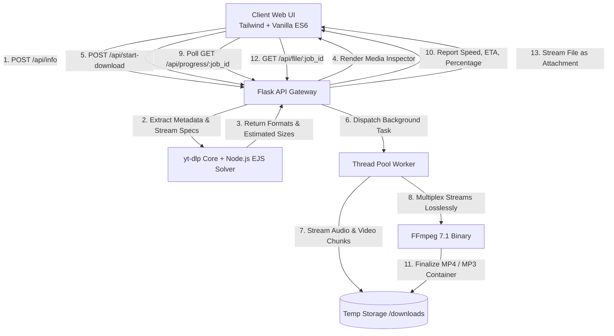

<div align="center">

# 🎬 TubePull
### High-Fidelity YouTube Video & Audio Workstation Engine

[](https://python.org)
[](https://github.com/yt-dlp/yt-dlp)
[](https://ffmpeg.org)
[](https://tailwindcss.com)
[](LICENSE)
[](#-deployment)

<p align="center">
  A studio-grade, self-hosted web application engineered for lossless extraction of YouTube videos, audio streams, and Shorts. Built with an obsidian dark workstation aesthetic inspired by Linear, Cobalt, and Apple interfaces.
</p>

[Key Features](#-key-features) • [Architecture](#-architecture) • [Getting Started](#-getting-started) • [API Reference](#-api-reference) • [Deployment](#-deployment) • [Disclaimer](#-legal--fair-use-disclaimer)

</div>

---

## 🌟 Key Features

### 🎞️ Video Extraction Pipeline
- **Lossless Stream Remuxing**: Multiplexes separate high-bitrate video streams (up to 4K 2160p @ 60 FPS) and pristine audio streams into standard MP4 containers without transcode artifacts.
- **Dynamic Resolution Negotiation**: Automatically detects and surfaces every available stream format: `4K UHD (2160p)`, `2K QHD (1440p)`, `1080p FHD`, `720p HD`, `480p`, and `360p`.
- **Accurate File Size Estimation**: Pre-calculates exact projected file sizes using stream metadata and bitrate matrices prior to downloading.

### 🎧 Studio Audio Extraction
- **Audiophile-Grade MP3**: Converts streams to Constant Bitrate (CBR) MP3 at **320 kbps** and **192 kbps** with full metadata tags.
- **Original AAC Stream Copy (`.m4a`)**: Instant zero-re-encoding extract of the raw audio container directly from YouTube servers.

### ⚡ Workstation User Experience
- **Tactile Obsidian Interface**: Human-crafted dark canvas (`#08090d`) with subtle ambient bloom, zero generic AI design tropes, and custom CSS micro-interactions.
- **Universal Omni-Bar**: Clipboard auto-paste (`Ctrl+V`), immediate link inspection, and keyboard navigation (`Enter` to inspect, `Esc` to reset).
- **Live Stream Telemetry**: Real-time throughput reporting (`MB/s`), accurate ETA countdowns, and transparent FFmpeg remuxing logs.
- **Session History Drawer**: Client-side localStorage persistence for quick access and re-inspection of previously extracted media.

---

## 🏗️ Architecture

TubePull decouples the inspection and extraction workflows through a multi-threaded asynchronous pipeline:



---

## 📁 Project Structure

```
youtube-downloader/
├── app.py                  # Core Flask backend & async extraction orchestrator
├── requirements.txt        # Production Python dependencies
├── Dockerfile              # Container specification (Debian Slim + FFmpeg + Node.js)
├── Procfile                # Gunicorn process manager for cloud PaaS (Render/Railway)
├── run.bat                 # Windows 1-click launch script with environment verification
├── push_to_github.bat      # Automated Git remote push utility
├── README.md               # Engineering & deployment documentation
│
├── templates/
│   └── index.html          # Semantic HTML5 layout with workstation theme
│
├── static/
│   ├── css/
│   │   └── style.css       # Custom scrollbars, glassmorphic glow, and active pill states
│   └── js/
│       └── app.js          # Reactive UI controller, clipboard parser, and telemetry polling
│
└── downloads/              # Ephemeral buffer storage (auto-purged after 60 minutes)
    └── .gitkeep
```

---

## 🚀 Getting Started

### Prerequisites
- **Python 3.10+**
- **Node.js 18+** *(Recommended for solving modern YouTube cipher challenges)*
- **Git**

### Installation

1. **Clone the repository**:
   ```bash
   git clone https://github.com/Ashesh88/youtube-downloader.git
   cd youtube-downloader
   ```

2. **Create a virtual environment**:
   ```bash
   # Windows
   python -m venv venv
   venv\Scripts\activate

   # Linux / macOS
   python3 -m venv venv
   source venv/bin/activate
   ```

3. **Install dependencies**:
   ```bash
   pip install -r requirements.txt
   ```
   > *Note: `imageio-ffmpeg` automatically manages and bundles a portable static FFmpeg binary — no separate manual FFmpeg installation required.*

4. **Launch the server**:
   - **Windows**: Double-click `run.bat` or run:
     ```powershell
     python app.py
     ```
   - **Linux / macOS**:
     ```bash
     python3 app.py
     ```

5. **Access the application**:
   Open **[http://localhost:5000](http://localhost:5000)** in your browser.

---

## 📡 API Reference

TubePull exposes a clean, decoupled REST API for headless integrations:

### 1. Inspect Video Metadata
`POST /api/info`

**Payload:**
```json
{
  "url": "https://www.youtube.com/watch?v=dQw4w9WgXcQ"
}
```

**Response (`200 OK`):**
```json
{
  "success": true,
  "data": {
    "id": "dQw4w9WgXcQ",
    "title": "Rick Astley - Never Gonna Give You Up",
    "channel": "Rick Astley",
    "duration": "03:33",
    "thumbnail": "https://i.ytimg.com/vi/dQw4w9WgXcQ/maxresdefault.jpg",
    "views": "1.5B",
    "video_options": [
      {
        "id": "1080",
        "label": "1080p Full HD",
        "resolution": "1080p",
        "badge": "1080p FHD",
        "desc": "1920×1080 • Crystal Clear",
        "size": "~122.3 MB",
        "is_default": true
      }
    ],
    "audio_options": [
      {
        "id": "mp3_320",
        "label": "MP3 Extreme (320 kbps)",
        "badge": "320 KBPS",
        "size": "8.5 MB"
      }
    ]
  }
}
```

### 2. Dispatch Extraction Job
`POST /api/start-download`

**Payload:**
```json
{
  "url": "https://www.youtube.com/watch?v=dQw4w9WgXcQ",
  "type": "video",
  "option_id": "1080",
  "title": "Rick Astley - Never Gonna Give You Up"
}
```

**Response (`200 OK`):**
```json
{
  "success": true,
  "job_id": "cf4040fd-5fe7-4ed4-af47-fa6fa08e8545"
}
```

### 3. Query Real-Time Telemetry
`GET /api/progress/<job_id>`

**Response (`200 OK`):**
```json
{
  "success": true,
  "status": "downloading",
  "progress": 68.4,
  "speed": "14.8MiB/s",
  "eta": "00:04",
  "message": "Downloading streams... 68.4%",
  "file_size": "122.3 MB",
  "error": null
}
```

### 4. Fetch Completed Asset
`GET /api/file/<job_id>`

Returns standard HTTP `200` binary stream with `Content-Disposition: attachment; filename="<sanitized_title>.mp4"`.

---

## ☁️ Deployment

### Deploy to Render (Recommended Free PaaS)
1. Fork or push this repository to your GitHub account (`https://github.com/Ashesh88/youtube-downloader`).
2. Log in to [Render.com](https://render.com) and create a **New Web Service**.
3. Select your repository.
4. Render automatically detects the configuration:
   - **Environment**: `Docker` or `Python 3`
   - **Build Command**: `pip install -r requirements.txt`
   - **Start Command**: `gunicorn app:app --bind 0.0.0.0:$PORT --workers 2 --timeout 300`
5. Click **Deploy Web Service** to obtain a production `https://*.onrender.com` URL.

### Deploy with Docker
```bash
# Build the production image
docker build -t tubepull:latest .

# Run the container
docker run -d \
  --name tubepull \
  -p 5000:5000 \
  -e PORT=5000 \
  --restart unless-stopped \
  tubepull:latest
```

---

## 🔒 Automated Buffer Cleanup

To prevent disk saturation when running indefinitely on servers:
- Files in the `downloads/` directory are tracked by their modification timestamps (`mtime`).
- The garbage collector automatically sweeps and unlinks temporary files older than **60 minutes**.
- Active background downloads are locked via threading primitives to prevent race conditions during write/merge cycles.

---

## ⚖️ Legal & Fair-Use Disclaimer

TubePull is an open-source utility designed exclusively for personal archiving, educational research, and legitimate fair-use purposes (such as content you own or content distributed under Creative Commons licenses).

- Users are responsible for complying with YouTube's Terms of Service and applicable local copyright laws.
- The developers do not endorse or encourage the unauthorized distribution of copyrighted material.

---

## 📄 License

Distributed under the **MIT License**. See `LICENSE` for more information.

<div align="center">
  <sub>Crafted with precision by <a href="https://github.com/Ashesh88">Ashesh Singh</a></sub>
</div>
